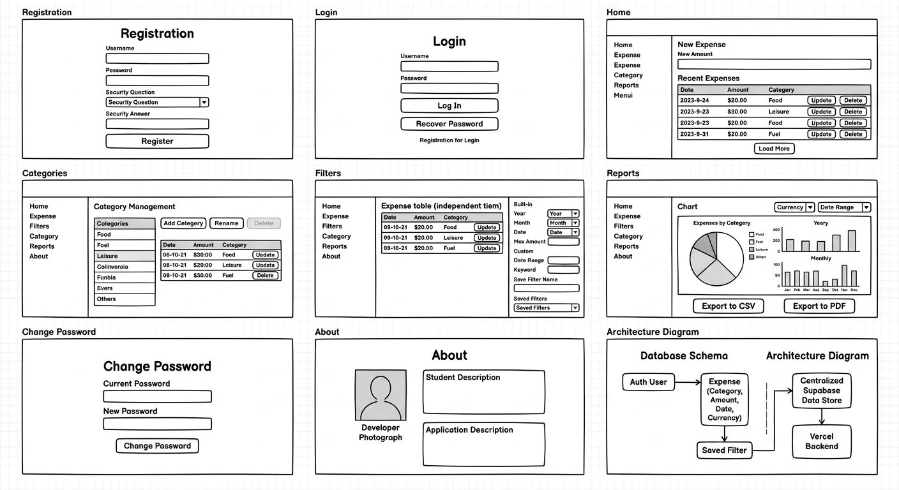
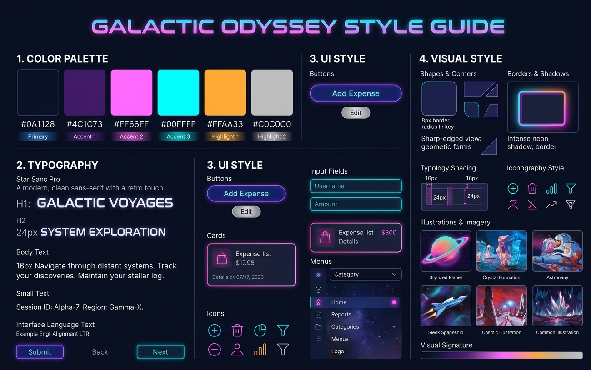
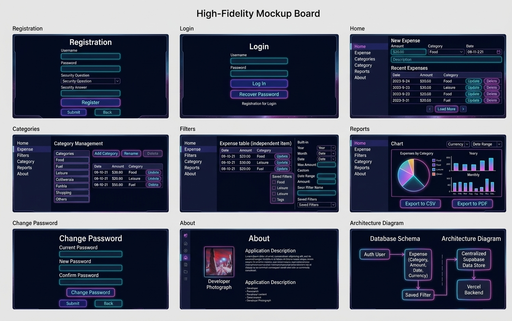

# DESIGN.md

## 1. Screens – Application Screens

The application comprises a set of main operational screens structured to guide the user from authentication through central expense tracking, analysis, and system architecture visibility. Below is the description of each screen based on the design mockups and wireframes:

*   **Registration**
    *   **Screen Purpose:** Enables new users to create a secure personal account by providing credentials and setting up a password recovery security question.
    *   **Structure and Content:** Features a centered card layout containing input fields for Username and Password, a dropdown selector for the pre-defined Security Question, an input field for the Security Answer, and primary action buttons (`Register` / `Submit` and `Back`).
    *   **Actions and Navigation:** Submitting valid registration data authenticates the user and transitions them into the main application; clicking back returns to the login entry point.

*   **Login**
    *   **Screen Purpose:** Provides returning users with secure access to their central expense database across devices.
    *   **Structure and Content:** Displays input fields for Username and Password, a prominent primary `Log In` button, secondary recovery controls (`Recover Password`), and a link redirecting to the Registration screen.
    *   **Actions and Navigation:** Authenticates user credentials to access the Home screen or navigates to the recovery/registration flows.

*   **Home**
    *   **Screen Purpose:** Acts as the central hub for managing expenses, allowing users to add, update, delete, and view paginated expense records alongside category selections.
    *   **Structure and Content:** Utilizes a persistent side navigation menu, a top-aligned "New Expense" form containing fields for Amount, Category dropdown, Date, and Description, and a "Recent Expenses" table featuring columns for Date, Amount, and Category with row action buttons (`Update`, `Delete`) and a `Load More` pagination trigger.
    *   **Actions and Navigation:** Users can perform CRUD operations on expenses or use the left-hand navigation menu to seamlessly switch between Home, Expense Filters, Categories management, Reports, and About views.

*   **Categories**
    *   **Screen Purpose:** Empowers users to manage custom and predefined expense categories (adding, renaming, or deleting).
    *   **Structure and Content:** Displays a side navigation menu alongside a "Category Management" module containing a list/table of active categories, action buttons (`Add Category`, `Rename`, `Delete`), and an associated expenses breakdown table.
    *   **Actions and Navigation:** Modifies category mappings which dynamically update across expense creation modules, with standard navigation links to other application pages.

*   **Filters**
    *   **Screen Purpose:** Provides an independent workspace to query and filter expense records using built-in constraints or custom keyword/date parameters, with options to save configurations.
    *   **Structure and Content:** Features a side navigation bar, an independent expense results table, a structured panel for built-in filters (Year, Month, Date, Max Amount), custom range controls, and a saved filters selector component.
    *   **Actions and Navigation:** Applying filters updates the isolated results table; custom filters can be saved for rapid future retrieval.

*   **Reports**
    *   **Screen Purpose:** Delivers visual analytics and summary insights into spending habits categorized by currencies, categories, years, and months, alongside export tools.
    *   **Structure and Content:** Includes top-level currency and date range selectors, a category breakdown Pie Chart, Yearly and Monthly Column Charts powered by Recharts, and prominent export triggers (`Export to CSV`, `Export to PDF`).
    *   **Actions and Navigation:** Users can switch reporting metrics or trigger file downloads of filtered or complete datasets.

*   **Change Password**
    *   **Screen Purpose:** Allows authenticated users to securely update their account password by verifying their existing credentials.
    *   **Structure and Content:** Features a centered modal/card layout containing input fields for `Current Password`, `New Password`, and `Confirm Password`, alongside `Change Password` / `Submit` and `Back` buttons.
    *   **Actions and Navigation:** Successfully submitting updates the security credentials or returns the user to the application dashboard.

*   **About**
    *   **Screen Purpose:** Displays static metadata regarding the application and the developer profile.
    *   **Structure and Content:** Renders static text blocks describing the application and student/developer background, accompanied by a dedicated placeholder frame for a developer photograph.
    *   **Actions and Navigation:** Serves as a static reference page accessible from the primary navigation menu.

*   **Architecture Diagram**
    *   **Screen Purpose:** Provides a structural system diagram outlining the application's technical topology, database schema relationships, and deployment pipeline.
    *   **Structure and Content:** Consists of structured block diagrams mapping out Database Schema entities (Auth User, Expense, Saved Filter) and Centralized Supabase/Vercel backend infrastructure relationships.
    *   **Actions and Navigation:** Serves as a technical documentation visual layout view.

### Overall Navigation Structure
The application employs a consistent persistent side menu layout across active operational screens (Home, Categories, Filters, Reports, About), ensuring fluid switching between modules. Authentication flows (Registration, Login, Change Password) utilize dedicated focused card layouts with explicit forward and backward submission actions.

---

## 2. Style Guide – Visual Design Language

The visual design language is rooted in a **"Galactic Odyssey"** aesthetic, featuring deep cosmic tones paired with high-contrast neon accents, clean typography, and geometric card elements.

### Color Palette
*   **Primary Background:** Deep Cosmic Navy (`#0A1128`)
*   **Accent 1 (Structure/Panels):** Muted Deep Violet (`#4C1C73`)
*   **Accent 2 (Primary Highlights):** Neon Pink/Magenta (`#FF66FF`)
*   **Accent 3 (Interactive Elements):** Bright Cyan/Teal (`#00FFFF`)
*   **Highlight 1 (Warnings/Alerts):** Cosmic Amber (`#FFAA33`)
*   **Highlight 2 (Neutrals/Text):** Soft Light Gray (`#C0C0C0`)

### Typography
*   **Font Family:** Star Sans Pro (a modern, clean sans-serif typeface with a distinct geometric retro touch).
*   **Hierarchy & Scale:**
    *   **H1 (Screen Headings):** Bold, high-impact uppercase style (e.g., `GALACTIC VOYAGES`).
    *   **H2 (Section Titles):** 24px styled uppercase titles (`SYSTEM EXPLORATION`).
    *   **Body Text:** 16px standard clean legibility scale for data entries and descriptive paragraphs.
    *   **Small Text:** Compact helper strings (e.g., Session IDs, status metadata).

### UI Style
*   **Buttons:** Outlined or solid Pill/Rounded shapes featuring glowing border gradients and high-contrast hover states (`Add Expense`, `Edit`, `Submit`).
*   **Input Fields:** Dark-themed text fields enclosed in subtle neon-cyan borders (`#00FFFF`), featuring clear label placement and padded click targets.
*   **Cards & Containers:** Rectangular panels framed with thin, elegant purple/magenta borders and rounded 8px corners to structure form inputs and data tables.
*   **Menus:** Vertical list modules integrating minimalist icons with left-aligned labels and active-state indicators.
*   **Icons:** Minimalist, clean-lined vector icons representing navigation paths, file actions (CSV/PDF downloads), trash/delete commands, and filters.

### Visual Style
*   **Shapes & Corners:** Geometric forms utilizing sharp structural borders paired with softened 8px rounded container corners.
*   **Borders & Shadows:** Distinct neon-glow multi-layered shadows and bright borders (`#FF66FF` / `#00FFFF`) to create depth against the dark space background.
*   **Spacing & Layout:** Balanced padding utilizing structured 16px/24px grid intervals to maintain visual breathing room across form inputs and data grids.
*   **Imagery & Illustrations:** Atmospheric cosmic artwork, stylized planets, crystal formations, and sleek spacecraft graphics reinforcing the thematic design narrative.

### Language and Directionality
*   **Interface Language:** English exclusively, as mandated by product specifications.
*   **Directionality & Alignment:** Left-to-Right (LTR) text flow with standard left-aligned table data and form labels.

---

### Design Reference Artifacts

*   **Wireframes (`wireframes.png`)**:
    

*   **Style Guide (`style-guide.png`)**:
    

*   **Mockups (`mockups.png`)**:
    